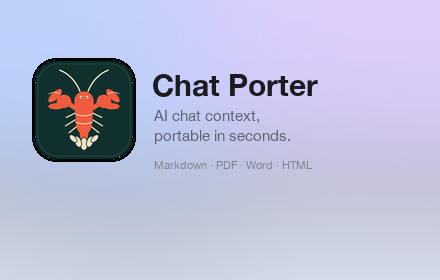

# Chat Porter

**Export ChatGPT, Claude, Gemini, DeepSeek, and Grok conversations as Markdown, PDF, Word, HTML, JSON, or plain text — or copy compact context to continue in another AI.**

[Website](https://tanaybpatel.github.io/porter/) · [Privacy](https://tanaybpatel.github.io/porter/privacy.html) · [Support](https://tanaybpatel.github.io/porter/support.html) · [Uninstall feedback](https://forms.gle/iT4ms5Rx5WYvEFa57)

> **Chrome Web Store:** listing coming soon. Replace this line with the store link after approval.



## What it does

Chat Porter is a Chrome extension for exporting AI chat conversations without sending anything to a server.

- **Context mode** — a compact hand-off pack for continuing the conversation in another AI. Older turns are condensed; the latest exchange stays in detail.
- **Export mode** — review every message, tick exactly what you want, and download Markdown, PDF, Word, HTML, JSON, or plain text.
- **Attachments** — PDFs, documents, spreadsheets, presentations, archives, and code files are detected and included as named, typed links.
- **Thinking blocks** — keep or remove the assistant’s reasoning with one checkbox.
- **Message selection** — search, filter by You/AI, select all/none, and preview before downloading.

## Supported sites

| Site | URL |
| --- | --- |
| ChatGPT | chatgpt.com, chat.openai.com |
| Claude | claude.ai |
| Gemini | gemini.google.com |
| DeepSeek | chat.deepseek.com |
| Grok | grok.com, x.com/i/grok |

## Privacy

Everything is processed locally in the browser. There are no accounts, analytics, tracking pixels, servers, or remote code. Conversation content is never transmitted.

The only optional data you can choose to send is an [uninstall feedback](https://forms.gle/iT4ms5Rx5WYvEFa57) response. Read the full [privacy policy](https://tanaybpatel.github.io/porter/privacy.html).

## Feedback and support

- **Support:** [support.html](https://tanaybpatel.github.io/porter/support.html)
- **Email:** [tanaydevporter@gmail.com](mailto:tanaydevporter@gmail.com)
- **Remove the extension?** [Tell us why](https://forms.gle/iT4ms5Rx5WYvEFa57) — it takes about 20 seconds.

## This repository

This repo hosts the public website, privacy policy, and support page for Chat Porter:

```
index.html       landing page
privacy.html     privacy policy
support.html     support and FAQ
404.html         branded not-found page
favicon.png      site icon
promo.png        social/readme preview
screenshot.png   landing-page screenshot
robots.txt       crawler rules
sitemap.xml      sitemap for search engines
.nojekyll        serve the files directly via GitHub Pages
```

The extension will be distributed through the Chrome Web Store. Built with Chrome Manifest V3 and TypeScript/esbuild; all PDF and Word generation runs locally.

## Not affiliated

Chat Porter is an independent project and is not affiliated with OpenAI, Anthropic, Google, DeepSeek, or xAI. Site names and logos are trademarks of their respective owners.
